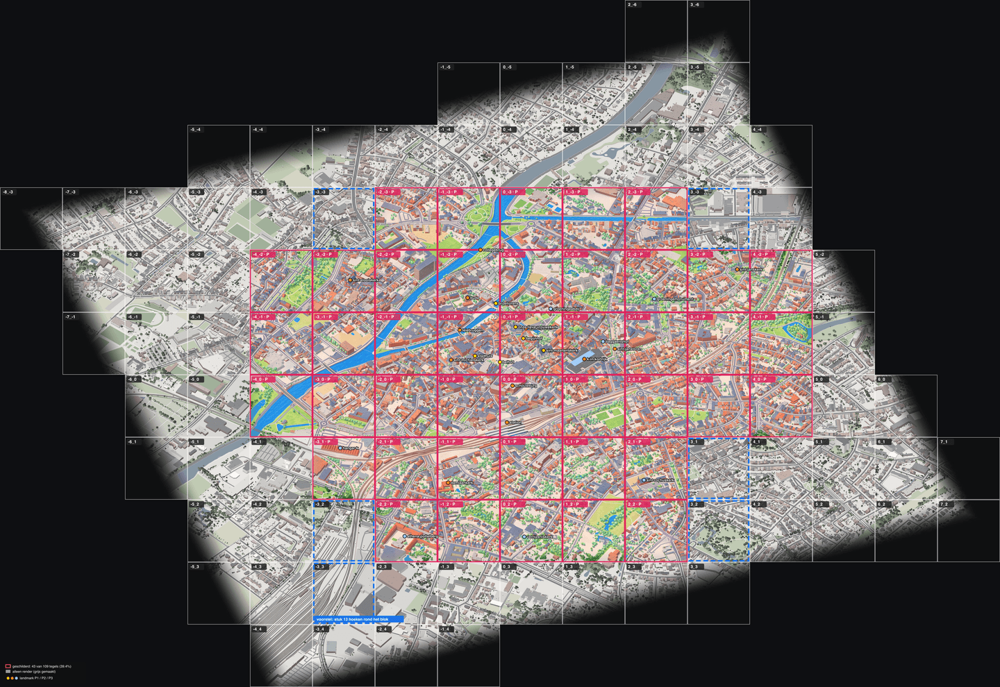

# Paint status (single source of truth)

What is painted on the live map and what is not. **Update this file after every paint run and every publish**: the tile grid, the numbers, the date and the landmark table. Read the facts off the data, not from memory:
- `data/derived/kortrijk-binnenstad/paint/`: which tiles are painted.
- `windows/`: which windows exist.
- `openai-usage.jsonl`: calls, model and time.
- `manifest.json`: the tile list.
- The `npm run export` log line `N rendered, M painted tiles`.

Regenerate `docs/paint-status.png` when the grid changes.

Last updated: **2026-11-13**, after the publish of pieces 8-12 at about 15:15 CET (1 591 files to R2, no Worker redeploy needed). Before that: the piece 7 publish of about 13:30 CET (571 files to R2, no Worker redeploy needed). Before that: the piece 6 publish of about 12:00 CET (487 files to R2, no Worker redeploy needed). Before that: the piece 5 publish of 2026-11-11 about 23:15 CET (3 915 files: the `scene.ts` fixes changed renders all over the map). Before that: piece 4b at 22:20, piece 4 at 22:00. Before that: the 1600 m map publish of about 21:10 CET (4 697 files to R2 bucket `simkortrijk`, region `kortrijk`, every tile re-exported because the edge fade moved; Worker redeployed). Before that: piece 3 at 19:05, the HD publish at 17:32.



## Working rule: one piece at a time (Tom, 2026-11-11)

The map is painted in **pieces** (`stukken`): a few neighbouring tiles, or one landmark fix plus its repaint. For every piece:

1. **Propose before painting.** Show `docs/paint-status.png` and give the tiles and windows, the landmarks in them and their render fixes, the estimated calls and cost, and which reference material would help (photos of the facades that face the camera, i.e. south-south-west, since the camera looks along heading 20°).
2. **Wait for Tom.** He approves, changes the scope, and may add reference material (into `pipeline/landmarks/<slug>/refs/`, listed in `refs/SOURCES.md`; his own photos may go into a paint request, Commons images only if their licence allows). No paint call before his go.
3. **Do the piece**: render fixes, check the render with Tom where a landmark changed, paint, check the windows by eye, assemble, export, and show the result before publishing.
4. **Record progress** right after: the piece table and the summary in `docs/PAINT_STATUS.md` (tiles painted, % of the binnenstad, calls and cost, date), and regenerate `docs/paint-status.png` with `cd pipeline && npx tsx src/paintstatus.ts --next "<tiles>" --label "voorstel: stuk N ..."` (after an export). Then propose the next piece.

## Pieces

| # | Piece | Tiles | Landmarks | Status | Calls / cost | Date |
|---|---|---|---|---|---|---|
| 0 | Broeltorens block | `-2_-2` `-1_-2` `0_-2` `-2_-1` `-1_-1` `0_-1` | Broeltorens + Broelbrug, Sint-Maartenskerk (fixed); Belfort, stadhuis, OLV-kerk, Begijnhof, Buda, Collegebrug, Groeningeabdij painted from the uncorrected render | **done**, live | 11 / ~$0.98 | 2026-11-11 |
| 1 | Grote Markt | repaint the Belfort and stadhuis windows in `-1_-1` / `0_-1`; paint `-1_0` `0_0` | Belfort, historisch stadhuis (P1, render fix first); Stadsschouwburg, station (P2) | **done**, live (published 18:27 CET, 214 files): render fixed (`belfort/massing.json`, `stadhuis/massing.json`), windows `-1_-1` and `0_-1` repainted, `-1_0` and `0_0` painted, tiles `-1_-1` `0_-1` `-1_0` `0_0` reassembled | 4 / ~$0.36 | 2026-11-11 |
| 2 | OLV-kerk, Begijnhof, east side | repaint `0_-1` after the OLV and Begijnhof fixes; paint `1_-2` `1_-1` | OLV-kerk + Gravenkapel, Begijnhof (P1, render fix first); K in Kortrijk + Sint-Janstoren (P2); Baggaertshof (P3) | **done**, live (published 18:46 CET, 236 files): OLV-kerk (`massing.json`) and Begijnhof (`colours.json`) fixed; windows `0_-2` `0_-1` repainted, `1_-2` `1_-1` painted, tiles `0_-2` `0_-1` `0_0` `1_-2` `1_-1` reassembled. K in Kortrijk, Sint-Janstoren and Baggaertshof painted from the uncorrected render | 6 / ~$0.54 (2 repaints after the OLV came out as a palace, see below) | 2026-11-11 |
| 3 | West: Sint-Elooiskerk, Leie, Noordbrug | paint `-3_-2` `-3_-1` `-3_0` `-2_0` (scope widened: the Noordbrug pylon stands in `-3_0`, and `-2_0` closes the gap); repaint `-2_-2` `-2_-1` (their left edge was a feather) | Sint-Elooiskerk (`massing.json`), Noordbrug (render edit `leiebruggen/edit_noordbrug.ts`: pylon and stays drawn before painting, restored after) | **done**, live (published 19:05 CET, 455 files) | 9 / ~$0.81 | 2026-11-11 |
| – | Bigger map (Tom chose option C of "map edge") | area `kortrijk-binnenstad` grown from 800 m to 1600 m around the Belfort: 29 → **109** tiles (80 new render tiles, 14 old edge tiles re-rendered with the data that was missing outside the old bbox). Fetch, colours, ground, scene, render, full re-export (the edge fade moved), publish, redeploy | – | **done**, live | 0 paint calls | 2026-11-11 |
| 4 | East: K in Kortrijk, Baggaertshof, Groeningemonument | fix K in Kortrijk + Sint-Janstoren and Baggaertshof, repaint `1_-1`; paint `1_0` `2_-2` `2_-1` `2_0` (and repaint the edge windows that feather into them) | K in Kortrijk + Sint-Janstoren (P2), Baggaertshof (P3), Groeningemonument (P3) | **done**, live (published about 22:00 CET, 435 files, Worker redeployed). References found online by Claude (Tom's request): Commons photos (side views) and Digitaal Vlaanderen orthophotos (top views) in the landmark `refs/`. Render fixed: `k-in-kortrijk/massing.json` (dark stone block 16.8 m + glass **hip** roof to 25 m; the orthophoto shows a hip, not a barrel), `sint-janstoren/massing.json` + `colours.json` (white stepped tower, dark plinth, roof garden), `baggaertshof/colours.json`. Window `1_-1` repainted; `1_0` `2_-3` `2_-2` `2_-1` `2_0` `3_-3` `3_-2` `3_-1` `3_0` painted (the `3_*` and `2_-3` windows cover the right and top 256 px of the new tiles and start the next pieces); tiles `0_-1` `0_0` `1_-2` `1_-1` `1_0` `2_-2` `2_-1` `2_0` reassembled. Edge windows `1_-2` / `0_0` were not repainted: the joins look seamless | 10 / ~$0.90 | 2026-11-11 |
| 4b | Tom's feedback on piece 4 | repaint `1_-1`, `1_0`, `2_-2`; tiles `0_-1` `0_0` `1_-2` `1_-1` `1_0` `2_-2` `2_-1` reassembled | K in Kortrijk: Street View showed light grey concrete facades, a recessed timber top storey, the Koeiekop entrance with a big angled canopy and a red K logo → podium style 2 + recessed `poly` storey (new part type in `scene.ts`) + glass atrium in `massing.json`, canopy and logo drawn by `k-in-kortrijk/edit_k.ts`; Groeningemonument was an 8 m brick "house" (GRB KNW 27592) → `groeningemonument/massing.json` (stone base, pedestal, gilded statue and spear) | **done**, live (published about 22:20 CET, 348 files) | 3 / ~$0.27 | 2026-11-11 |
| 5 | South: station and below the railway | paint `-2_1` `-1_1` `0_1` `1_1`; repaint `1_-2` `1_-1` `-2_0` `-1_0` `0_0` (fake towers, stale station); windows `-3_1` `2_1` start the next pieces; 14 tiles reassembled | Station (`station/massing.json`: buff brick, raised hall, platform canopies traced on the orthophoto, bike parking), Damiaankerk + Karmelietenklooster (`massing.json`), and two `scene.ts` fixes for the whole map: GBA annex heights capped, LiDAR needles only on churches/towers (removed 150 fake spires: six "towers" on the Groeninge site in tile `1_-1`, others in `-2_0` and the south). References (done by Claude alone, Tom's request): 22 Commons photos + 11 orthophoto crops in `refs/`, and 12 Google Street View + 5 Google satellite screenshots looked at only (rule 1, not stored) | **done**, live (published about 23:15 CET, 3 915 files, Worker redeployed) | 17 / ~$1.50 (11 + 6 repaints: `-2_0` copied the style image (twice), `0_0` invented water that leaked into `0_1`, and `-1_0` / `-2_1` carried the bad `-2_0` strip) | 2026-11-11 |
| 6 | East and west edges | paint `3_-1` `3_0` `2_1` `-3_1`; windows `3_-1` `3_0` repainted (a fake tower from before the piece 5 cleanup), `2_1` `-3_1` repainted (landmark render fixes), `4_-2` `4_-1` `4_0` `3_1` `-4_1` new, `2_1` repainted once more after the shed fix below; tiles `3_-1` `3_0` `2_1` `-3_1` `-3_0` `-2_0` `-2_1` `1_0` `1_1` `2_-2` `2_-1` `2_0` reassembled | Sint-Rochuskerk (`massing.json`: dark brick, one slate roof, choir with apse, brick west tower with a slate needle and four pinnacles; the render had a cream box with a stubby cream octagon), Hangar K (`massing.json`: 16 gabled red bays instead of one flat slab). One `scene.ts` fix for the whole map: small GBG outbuildings (`bijgebouw`, under 40 m²) measured on the DSM are capped at 9 m like GBA annexes (a 13 m² garden shed under a tree was a 23 m white needle in the park next to the Sint-Rochuskerk; 80 such sheds on the map). Only the tiles of this piece were re-rendered (`2_1` `-3_1` `3_-1` `4_-2` `4_0` `3_1`; the east ones changed 0.03–0.04%, their windows were kept). References (Claude alone, Tom's request): 6 Commons/Onroerend Erfgoed photos + 2 orthophoto crops in `refs/`; Street View (Pijlstraat, Sint-Rochus parking, Nelson Mandelaplein) and Google satellite looked at only | **done**, live (published about 12:00 CET, 487 files) | 10 / ~$0.90 (1 repaint: `2_1` after the shed fix) | 2026-11-13 |
| 7 | North-east: Sint-Janskerk and the canal | paint `3_-2` `2_-3` `1_-3`; windows `4_-2` (had the church as a 49 m slab) and `3_-3` (painted before the piece 5 cleanup) repainted, `4_-3` `1_-3` `1_-4` `2_-4` `3_-4` new, `2_-3` `3_-2` reused (checked against the render); tiles `3_-2` `2_-3` `1_-3` `0_-2` `1_-2` `2_-2` `2_-1` `3_-1` reassembled | Sint-Janskerk (`massing.json`: buff stone cruciform church, crossing tower with slate needle and corner turrets, rose-window fronts; the render had the whole footprint extruded to 49 m). 13 render tiles in the piece area re-rendered with the shed cap of piece 6 (8 changed). Done by Claude on its own with the new `paint-piece` skill (Tom: "zelfstandig"). References: 6 Commons photos + orthophoto; no Street View (browser not connected) | **done**, live (published about 13:30 CET, 571 files) | 7 / ~$0.63 | 2026-11-13 |
| 8 | South row, east: Verrijzeniskerk | paint `0_2` `1_2` `2_2`; windows `0_2` `1_2` `2_2` `3_2` `0_3` `1_3` `2_3` `3_3` new; `1_3` copied the style image and `2_3` took that bad strip, both repainted (`1_3` with `PAINT_STYLE`) | Verrijzeniskerk (`massing.json`: white wall, green copper cone, lantern and spire; the render had a flat grey disc). The Sint-Rochuskerk is now fully in the paint. 12 render tiles of rows `ty` 2-3 re-rendered (shed cap; 2 identical) | **done**, live (published about 15:15 CET) | 10 / ~$0.90 | 2026-11-13 |
| 9 | South row, west: Athena campus Pottelberg | paint `-1_2` `-2_2`; windows `-1_2` `-2_2` `-3_2` `-1_3` `-2_3` `-3_3` new; `-3_2` (rail yard) copied the style image twice, then painted with `PAINT_STYLE` | Athena campus Pottelberg (`massing.json`: gabled school wings instead of a flat 27 m block). Pieces 8 and 9 were done in one run (Tom: "2 stappen vooruit"), tiles `-3_1` `-2_1` `-1_1` `0_1` `1_1` `2_1` reassembled with them | **done**, live (published about 15:15 CET) | 8 / ~$0.72 | 2026-11-13 |
| 10 | West edge: Overleie | paint `-4_-2` `-4_-1` `-4_0`; the old invented-city windows `-4_-2` `-4_-1` `-4_0` repainted from the real render, `-4_-3` `-5_-3` `-5_-2` `-5_-1` `-5_0` new; `-5_0` copied the style image, repainted with `PAINT_STYLE` | none (no named landmarks; a sloped 28 m block by the Leie looks plausible and was kept) | **done**, live (published about 15:15 CET) | 9 / ~$0.81 | 2026-11-13 |
| 11 | North: the Leie above the Broel block | paint `-2_-3` `-1_-3` `0_-3`; old window `0_-3` was mostly unpainted render (dark render trees) and was repainted; `-2_-3` `-1_-3` (excluded since piece 0) painted from the real render; `-3_-3` `-3_-4` `-2_-4` `-1_-4` `0_-4` new | none named (Leie, footbridge, island park, Budatoren side) | **done**, live (published about 15:15 CET) | 8 / ~$0.72 | 2026-11-13 |
| 12 | East edge | paint `4_-2` `4_-1` `4_0`; windows `4_-3` `4_-2` `4_-1` `4_0` from piece 6/7 reused, `5_-2` `5_-1` `5_0` new; `5_-3` skipped (half of it is outside the map) so the top right corner of `4_-2` fades into the render | none (the 34 m tower in `5_-1` lies outside the windows) | **done**, live (published about 15:15 CET) | 3 / ~$0.27 | 2026-11-13 |

Progress: **43 of 109** tiles painted (39.4%), all live. The old 800 m binnenstad (29 tiles) is now fully painted. Total so far: 115 paint calls, about $10.35.

Open follow-ups: none from piece 4. K in Kortrijk, the Sint-Janstoren and the Baggaertshof were fixed and repainted in piece 4.

How piece 1 was painted (and how the next pieces go): the local `windows/` held old pre-colour windows, so they are in `windows.old-local/`. The windows of the live block (`-2_-2` `-1_-2` `0_-2` `-2_-1` `0_-1`) were cut back out of the live paint tiles so new windows continue the live paint. To publish only what changed: empty `data/web/regions/<region>` and `data/web/<region>.state.json`, then `TILES_ORIGIN=https://pub-74f69231228247acb76f1009b1fa86f5.r2.dev npm run export -- kortrijk-binnenstad` (the lower zooms fetch unchanged tiles from R2, and `.env` leaves `TILES_ORIGIN` empty) and publish with the same `TILES_ORIGIN` plus the OAuth token (CLAUDE.md, Gotchas). Each window is painted alone (`npm run paint -- kortrijk-binnenstad --window=i,j [--force] --interactive`, `PAINT_PROVIDER=openai OPENAI_IMAGE_MODEL=gpt-image-2.6-flare PAINT_ATTEMPTS=1`), and only the tiles that change are reassembled (`python3 pipeline/tools/assemble_tiles.py --target=<all painted tiles> --rewrite=<changed tiles>`), with the usual 220 px feather into the render wherever a painted tile meets an unpainted one. The bottom ~220 px of a block are a feather into the render, so a block that grows downward or sideways repaints its edge windows too.

`render.orig/` (used by `broeltorens/edit_broel.py`) still holds renders from before the per-building colours. Do not run `edit_broel.py --restore` as is: it would put those stale renders back over `-1_-1` `-1_-2` `0_-1` `0_-2`. Re-render those tiles instead (`npm run render -- kortrijk-binnenstad --only=tx,ty --force`), or refresh `render.orig/` first. `edit_noordbrug.ts` keeps its own copies in `render.orig-noordbrug/`.

After reassembling tile `1_-1`, run `npx tsx landmarks/k-in-kortrijk/edit_k.ts --logo-on-paint` (from `pipeline/`): GPT drops the small red K logo, so it is drawn on the paint tile again. And repaint in landmark order: in 4b, `1_0` was painted before the new `1_-1`, which only worked because K does not reach into the `1_0` strip.

Pieces 10-12 lessons: `npm run render -- --only=tx,ty` renders any tile, also one outside the area's 109 (`5_-3` was created by mistake and deleted): check the grid before re-rendering. A window that is "painted and used" can still be mostly render (`0_-3` of piece 0): look at it before reusing it. Windows that are half outside the map (`5_-3`) are skipped, not painted.

Pieces 8-9 lessons: windows with little content (rail yards, open ground, sparse suburbs) come back as a copy of the style image (`match` ~0.05 with a shift, the Broeltorens and the Leie), and repeating the same call gives the same copy. `PAINT_STYLE=<a good painted window of a similar area>` (new in `paint.ts`) fixes it: `-3_2`, `1_3` and the rest of row `j` 3 were painted with `PAINT_STYLE` set to window `0_3`. A copy also spoils the next window through its strip (`2_3`): move both aside and repaint. Headless Chrome screenshots of the viewer can show a vertical line where z9 tiles have not loaded yet; check the paint tiles themselves before calling it a seam.

Piece 7 lessons: 3D GRB `HN_P99` of a church with a tower is the tower height, so the whole footprint renders as a tower-high block (Sint-Janskerk, 49 m): check every church footprint over ~25 m before painting its window. The method is now the `paint-piece` skill (`.claude/skills/paint-piece/SKILL.md`) with helper tools in `pipeline/tools/`: `landmarks_in_tiles.ts`, `landmark_measure.ts`, `landmark_refs.py`, `window_check.py`.

Piece 6 lessons: windows painted before a render change are stale even if they look fine (`3_-1` and `3_0` still had a fake tower from before the piece 5 cleanup); compare each existing window with the current render before reusing it. When a landmark is fixed under an existing window, move that window to `windows.replaced/` before painting its neighbours. To keep an old invented-city window (`-4_0`) from being pasted as a strip, move it out of `windows/` while its neighbour is painted and put it back for assembly (it is still used by tile `-3_0`). `npm run paint -- --window` also rewrites any paint tile whose windows all exist (it wrote `2_-1` `2_0` `1_0` `-2_0` `3_-1`); `assemble_tiles.py` overwrites them afterwards. The Python tools need `pillow numpy scipy` (the system Python on Tom's Mac has none; a venv works).

Piece 5 lessons: check every window by eye before the next one is painted. `-2_0` came back as a copy of the style image (Broeltorens and river; its `match` was 0.02 with a shift, a reliable sign), and `0_0` invented water; both were already pasted as strips into the next windows (`-1_0`, `-2_1`, `0_1`), which then had to be repainted too. A `match` below ~0.3 means: stop and repaint that window before going on.

Neighbour strips carry old paint along: in piece 2 the old `0_-1` window (OLV-kerk painted from the old 34.6 m box, a cream palace) was pasted into the new `0_-2`, which passed it on to the new `0_-1`, and the corrected church came out as a palace again. When a landmark's render changes, move the old windows that show it out of `windows/` before painting its neighbours, then paint outward from the landmark.

## Next up (agreed with Tom, 2026-11-11)

1. **Map edge: remove the black areas.** *Tom chose C (2026-11-11): done, the map is now 1600 m around the Belfort. The edge still fades to the dark page background, further out; A (cream paper) can still be added on top.* Outside the binnenstad there are no tiles, so the page background (`#0e0f12`) shows, and every edge tile fades into that dark colour over 220-740 art px (`EDGE0`/`EDGE1` and `BG` in `pipeline/src/export.ts`). That fade also darkens map content near the edge (the Sint-Elooiskerk spire). Options:
   - **A (recommended): cream paper.** Fade and fill to the style-A paper colour instead of black: `BG` in `export.ts` and `og.ts`, the page, map and preview backgrounds and `theme-color` in `web/src/components/MapPage.astro` (and `404.astro`). Then re-export everything (edge tiles and every lower zoom level are composited on `BG`), publish all tiles, rebuild and redeploy. No paint calls.
   - **B: a narrower fade** (smaller `EDGE0`/`EDGE1`) so less of the map is dimmed. Alone it shows the tile staircase along the outline; combine it with A or C.
   - **C: a bigger map**: a ring of extra render tiles around the binnenstad (new area: fetch, ground, scene, render, export). The edge moves outward but still exists; the new tiles are unpainted render.
2. **Piece 4, east** (done 2026-11-11, see the piece table; the briefing as proposed to Tom):
   - Render fixes first, then repaint window `1_-1`: K in Kortrijk (a large flat block in dark natural stone with a steel-and-glass barrel roof over the inner square), the Sint-Janstoren (11-storey residential tower, dark stone plinth, white cladding, trees on the roof), the Baggaertshof (whitewashed almshouses with red pantiles around a courtyard: a `colours.json` like the Begijnhof).
   - Then paint the east side: tiles `1_0` `2_-2` `2_-1` `2_0`, with the Groeningemonument and the rest of the Groeningepark. Repaint the existing windows whose edge feathers into these tiles (`1_-2`, `1_-1`, `0_0`) so the joins are seamless.
   - The south row (below the railway) was left out on purpose: it is mostly inside the map-edge fade.
   - Useful references from Tom: K in Kortrijk with its glass dome, the Sint-Janstoren, the Baggaertshof courtyard, the Groeningemonument and the Groeningepoort.
   - Estimate: ~9 calls, ~$0.80.

## Summary

| | |
|---|---|
| Area on the live map | `kortrijk-binnenstad`, since 2026-11-11 evening **1600 m** around the Belfort (bbox 50.813201,3.242863 – 50.841947,3.288372, 3.2 × 3.2 km: binnenstad, the whole ring, station quarter, Overleie, Kortrijk Weide, Sint-Jan). Before: 800 m (50.820387,3.254240 – 50.834760,3.276994), 29 tiles. The 800 m raw data is kept in `data/raw/kortrijk-binnenstad.800m/`, the replaced edge renders in `data/derived/kortrijk-binnenstad/pre-expand/`. |
| Render tiles (1024 px, 0.25 m/px, 256 m) | **109**, `tx` -8..7 × `ty` -6..4 (irregular, see grid); tile coordinates did not change |
| Web resolution | **HD**: native zoom 9 at 0.125 m/px from `render-hd/` (2048 px per tile), AVIF q65. The 6 painted tiles are 1024 px paint upscaled: they are no sharper than before until they are repainted at 2K into `paint-hd/`. |
| Painted tiles | **43**: `tx` -2..0 × `ty` -2..-1 (Broeltorens / Sint-Maarten block), `-1_0` `0_0` (piece 1), `1_-2` `1_-1` (piece 2), `-3_-2` `-3_-1` `-3_0` `-2_0` (piece 3), `1_0` `2_-2` `2_-1` `2_0` (piece 4), `-2_1` `-1_1` `0_1` `1_1` (piece 5), `3_-1` `3_0` `2_1` `-3_1` (piece 6), `3_-2` `2_-3` `1_-3` (piece 7), `0_2` `1_2` `2_2` (piece 8), `-1_2` `-2_2` (piece 9), `-4_-2` `-4_-1` `-4_0` (piece 10), `-2_-3` `-1_-3` `0_-3` (piece 11), `4_-2` `4_-1` `4_0` (piece 12) |
| Render-only tiles | **66**, showing the coloured 3D render (per-building colours, `--soften 0.5`), not painted |
| Coverage | **39.4%** of the map (43 of 109 equal tiles, all live); 100% of the old 800 m binnenstad (29 of 29) |
| Style | Style A + real colours (`.claude/skills/map-style`) |
| Painter | OpenAI `gpt-image-2.6-flare`, quality high, input fidelity high, `PAINT_ATTEMPTS=1` |
| Painted | 2026-11-11, 16:01–16:06 CET |
| Cost of the live paint | 11 calls, about **$0.98**: 1 test window, 8 block windows, 2 failed repaints of `-1_-3`. Each call is 4 754 input / 1 758 output tokens, about $0.09. |
| Rest of Kortrijk (area `kortrijk`, whole municipality) | **Not fetched, not rendered, not painted** (0 tiles) |

## Tile grid (`tx` across, `ty` down)

`P` = painted, `r` = coloured render only (the old 800 m area), `n` = coloured render only, new with the 1600 m area, `.` = no tile.

```
ty \ tx   -8  -7  -6  -5  -4  -3  -2  -1   0   1   2   3   4   5   6   7
  -6       .   .   .   .   .   .   .   .   .   .   n   n   .   .   .   .
  -5       .   .   .   .   .   .   .   n   n   n   n   n   .   .   .   .
  -4       .   .   .   n   n   n   n   n   n   n   n   n   n   .   .   .
  -3       n   n   n   n   n   n   P   P   P   P   P   n   n   .   .   .
  -2       .   n   n   n   P   P   P   P   P   P   P   P   P   n   .   .
  -1       .   n   n   n   P   P   P   P   P   P   P   P   P   n   .   .
   0       .   .   n   n   P   P   P   P   P   P   P   P   P   n   n   .
   1       .   .   n   n   n   P   P   P   P   P   P   n   n   n   n   n
   2       .   .   .   n   n   n   P   P   P   P   P   n   n   n   n   n
   3       .   .   .   n   n   n   n   n   n   n   n   n   .   .   .   .
   4       .   .   .   .   n   n   n   n   .   .   .   .   .   .   .   .
```

The painted edge tiles of the old map (`-3_-2` `-2_-2` `-3_0`) were checked against their new renders: only a few trees and kerbs outside the old bbox differ (0.4–2.8% of pixels), so their paint stays. Edge windows that GPT filled with an invented city (`-4_0`, `-2_-3`, `-1_-3`) now lie over real render tiles: repaint them from the new render before they are used as neighbour strips.

## Paint windows of the block

Windows are 1024 px at stride 896, so they overlap by 128 px. Window `i_j` starts at pixel (`i`·896, `j`·896). The whole binnenstad has **59 windows**, `i` -5..4 × `j` -4..3. **9** were painted for this block. **50** are not painted.

| Window | Status |
|---|---|
| `-2_-2` `-1_-2` `0_-2` `-2_-1` `-1_-1` `0_-1` `0_-3` | Painted and used. `-1_-2` (Broeltorens) was painted first and is also `pipeline/style/reference.png`. |
| `-2_-3` | Painted, **excluded**. It is mostly empty map edge (no tile at `-2_-3`), and GPT invents a city there. Its area stays coloured render. |
| `-1_-3` | Painted 3×, **excluded**. Same reason: it copied the style image twice and its neighbour once. The top ~384 px of tiles `-2_-2` and `-1_-2` stay coloured render, feathered in over ~220 px. |

Assembled with `python3 pipeline/tools/assemble_block.py --skip=-2_-3,-1_-3`. Before painting, run `edit_broel.py`; afterwards, `--restore`.

## Not painted yet

- **The rest of the map:** 66 tiles, all in the 1600 m ring. In order of interest:
  - the corners around the block: `3_1` `3_2` (east of the Sint-Rochuskerk), `-3_2` `-3_3` (rail yard), `3_-3` `-3_-3`: most of their windows are already painted (missing: `4_1` `4_2`, `-4_2` `-4_3`, `-4_-4`), then row `ty` 3 (`-2_3` .. `2_3`, needs row `j` 4);
  - then the 80 tiles of the 1600 m ring, starting from the painted `2_-3` and `3_*` windows in the east.

  Paint outward from the block so every new window has painted neighbours. Skip mostly-empty edge windows.
- **The whole municipality** (area `kortrijk`): nothing yet. It needs fetch, ground, scene and render first.

## Landmarks

Each landmark has notes, photos and a priority in `pipeline/landmarks/<slug>/` (see `pipeline/landmarks/README.md`).

| Prio | Landmark | Render fix | Tile | Painted |
|---|---|---|---|---|
| P1 | Broeltorens + Broelbrug | **done** (`edit_broel.py`) | `-1_-2` | **yes** |
| P1 | Sint-Maartenskerk | **done** (`massing.json`) | `0_-1` | **yes** (church with spire) |
| P1 | Belfort / Halletoren | **done** (`massing.json`, piece 1) | `-1_-1` | **yes** (piece 1) |
| P1 | Historisch stadhuis | **done** (`massing.json`, piece 1) | `-1_-1` | **yes** (piece 1) |
| P1 | Onze-Lieve-Vrouwekerk | **done** (`massing.json`, piece 2) | `0_-1` | **yes** (piece 2) |
| P1 | Begijnhof | **done** (`colours.json`, piece 2) | `0_-1` | **yes** (piece 2) |
| P2 | Artillerietoren | pending | `0_-1` | yes, from the uncorrected render |
| P2 | Sint-Michielskerk | pending | `-1_-1` | yes, from the uncorrected render |
| P2 | Buda (toren, fabriek, brug) | pending | `-1_-2` / `-2_-2` | yes, from the uncorrected render |
| P2 | Collegebrug | pending | `-1_-2` | yes, from the uncorrected render |
| P2 | Leiebruggen | Noordbrug **done** (render edit, piece 3); others pending | `-1_-1`, `-2_-1`, `-3_-1` | yes (piece 3) |
| P2 | Sint-Elooiskerk | **done** (`massing.json`, piece 3) | `-3_-2` | **yes** (piece 3); its spire was in the old map-edge fade (no longer: the map is bigger) |
| P2 | K in Kortrijk | **done** (`massing.json`, piece 4) | `1_-1` | **yes** (piece 4) |
| P2 | Sint-Janstoren | **done** (`massing.json` + `colours.json`, piece 4) | `1_-1` / `2_-1` | **yes** (piece 4) |
| P2 | Station | **done** (`massing.json`, piece 5) | `0_0` | **yes** (piece 5) |
| P2 | Stadsschouwburg | pending | row `ty` 0 | yes, from the uncorrected render (piece 1) |
| P2 | Damiaankerk + Karmelietenklooster | **done** (`massing.json`, piece 5) | `-1_1` | **yes** (piece 5) |
| P3 | Groeningeabdij | pending | `0_-2` | yes, from the uncorrected render |
| P3 | Baggaertshof | **done** (`colours.json`, piece 4) | `1_-1` | **yes** (piece 4) |
| P3 | Sint-Rochuskerk | **done** (`massing.json`, piece 6) | `2_1` | **yes** (piece 6, in the bottom fade of the tile until row `ty` 2 is painted) |
| P3 | Hangar K | **done** (`massing.json`, piece 6) | `-3_1` | **yes** (piece 6) |
| P2 | Sint-Janskerk | **done** (`massing.json`, piece 7) | `3_-2` | **yes** (piece 7) |
| P3 | Verrijzeniskerk | **done** (`massing.json`, piece 8) | `0_2` | **yes** (piece 8) |
| P3 | Athena campus Pottelberg | **done** (`massing.json`, piece 9) | `-2_2` | **yes** (piece 9) |
| P3 | Groeningemonument | none (too small for the massing; the park and plinth come from the render) | `2_-2` | **yes** (piece 4) |

Tiles are from the landmark's OSM position projected with `pipeline/src/camera.ts`. Station and Schouwburg are approximate.

## Restore points

**Local `paint/` (since the HD publish, 2026-11-11):** the 6 live painted tiles were rebuilt from the published z8 map tiles (AVIF q50, so one generation of compression), with the baked map-edge fade divided back out of `-2_-2`, `-1_-2` and `0_-2`. The original lossless paint is on the build box (`styleA-colour-preview/`); copy it over `paint/` when you have it. The older local paint (29 tiles, pre-colour) is in `paint.old-local/`, and `backup-prehd-2026-11-11/` holds render, scene and paint as they were before the HD run.

Restore points are on the build box under `/workspace/paintrun/` and are not in git. Each folder has `PUBLISH.md` with the exact commands.

| Folder | What it is |
|---|---|
| `styleA-colour-preview/` | **Live**: paint, windows, render, `building_colours.json`. |
| `styleA-gpt/` | Previous: coral GPT flare. |
| `pre-colour-snapshot/kortrijk-binnenstad/` | Previous: uniform render. |
| `styleA-gemini-live/` | Gemini. |

`publish --keep` leaves older objects on R2.
